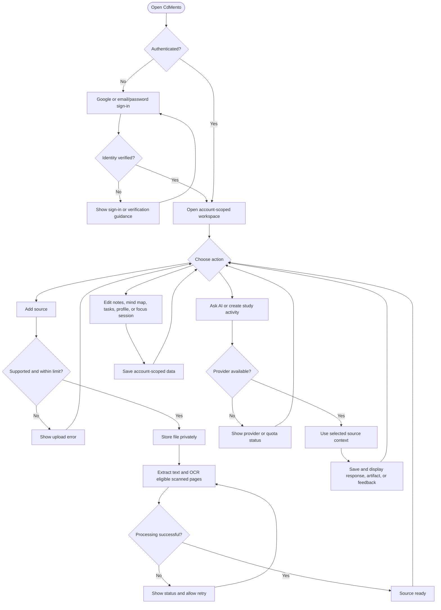
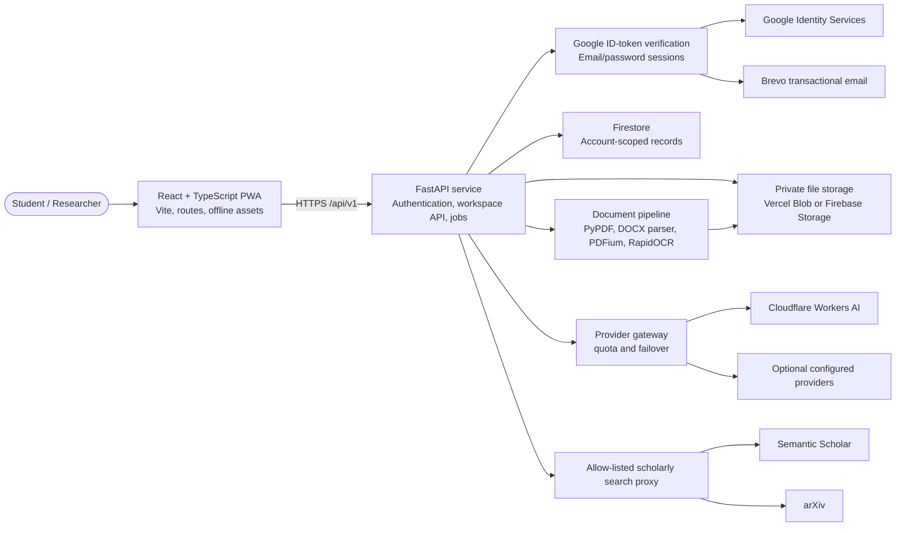

# CdMento — Your Space to Understand

> A modern, AI-powered study workspace designed for students, researchers, and lifelong learners to organize materials, master difficult concepts, and study smarter.

---

## 💡 What is CdMento?

**CdMento** is an intelligent web-based study platform and Progressive Web App (PWA). It brings together documents, lecture notes, visual mind maps, spaced repetition flashcards, quizzes, and an AI study assistant into a unified, distraction-free environment. 

Instead of juggling separate apps for notes, flashcards, PDF reading, and timers, CdMento connects your entire learning workflow to your source materials.

---

## ✨ Core Features

### 📚 Document Hub & Smart Ingestion
- Upload and organize course documents in **PDF**, **DOCX**, and **TXT** formats.
- **Offline OCR Engine**: Scanned or image-only PDF pages are automatically transcribed locally using bundled neural models without exposing data to third parties.
- Split-pane reading with side-by-side extracted text, page references, and section navigation.

### 📝 Rich-Text Study Notes
- Distraction-free, responsive block-based editor.
- Auto-saving, revision tracking, and real-time formatting.
- Notebook-level organization with color-coded categories and fast search.

### 🤖 Source-Grounded AI Study Assistant
- Ask questions grounded directly in your uploaded textbooks and lecture slides.
- Every answer includes verifiable source citations and page numbers.
- Automated creation of study guides, summaries, and key concept breakdowns.

### 🗂️ Spaced Repetition Flashcards (FSRS)
- Practice flashcards powered by the state-of-the-art **FSRS (Free Spaced Repetition Scheduler)** algorithm.
- AI card generator: Automatically extracts high-yield flashcard decks from any document section.
- Practice mode and due-date scheduling optimized for long-term memory retention.

### 🎯 Interactive Quizzes & Assessments
- Generate self-assessment quizzes in **Practice Mode** (instant explanations) or **Exam Mode** (timed assessment).
- Server-side grading with targeted weak-concept diagnostic feedback.

### 🧠 Concept Mind Maps
- Visualize relationships between topics with interactive node graphs.
- Add custom concepts or generate AI-assisted knowledge branches to structure complex topics.

### ⏱️ Focus Timer & Task Tracking
- Interval timer (Pomodoro technique) with custom work and rest periods.
- Session time tracking calculated against deadlines.
- In-session task checklist to maintain concentration.

### 📱 Progressive Web App (PWA) & Mobile Ready
- Installable on iOS, iPadOS, Android, macOS, and Windows.
- Offline support with background asset precaching via Service Workers.
- Mobile-first ergonomic touch interface compliant with WCAG AA accessibility standards.

---

## 🛠️ Tech Stack

| Layer | Technologies |
| --- | --- |
| **Frontend** | React 19 · TypeScript · Vite 8 · Tailwind CSS 4 · Zustand · React Router 7 · TipTap (ProseMirror) · @xyflow/react (React Flow) · PDF.js (`pdfjs-dist`) · Motion · Lucide React |
| **Backend** | Python 3.13 · FastAPI (async REST) · Pydantic v2 · SQLite · Firestore (hosted) · RapidOCR (ONNX Runtime, OpenCV, PyPDFium2) · PyFSRS · Celery + Redis |
| **AI & Search** | Cloudflare Workers AI (`llama-3.3-70b-instruct`) · Groq (`gpt-oss-120b`) · OpenRouter free tier · multi-provider failover gateway with JSON-schema enforcement |
| **Scholarly Sources** | Crossref · OpenAlex · Europe PMC · PubMed · arXiv · Semantic Scholar (optional API key) · Google Scholar link-out |
| **PWA & Accessibility** | Web App Manifest · Service Worker precaching · WCAG AA contrast · 44px touch targets |
| **Testing & Tooling** | Vitest + Testing Library · pytest · Prettier · TypeScript (`tsc --noEmit`) · GitHub · Vercel (optional hosting) |

---

## 🔒 Privacy & Data Architecture

- **Private by Design**: Source files, notes, and personal study data remain scoped to your account.
- **Source Grounding**: AI features operate strictly on the excerpts of documents you select.
- **Offline OCR**: Optical Character Recognition runs entirely on the local CPU; document images are never sent across the network for text extraction.
- **WCAG Accessible**: High-contrast typography, screen-reader landmarks, and minimum 44px touch targets.

---

## 🚀 Run locally

From the repository root, install the frontend and Python dependencies, then create your local environment file:

```powershell
npm ci
py -3.13 -m venv .venv
.\.venv\Scripts\python.exe -m pip install -r backend\requirements-dev.txt
Copy-Item .env.example .env
npm run dev:all
```

The template configures the shared CdMento Google OAuth client for local sign-in. Each teammate must be added as a test user in the Google Cloud project's **Google Auth Platform → Audience** while the app is in testing mode. Email/password signup and password reset use Brevo transactional email; configure `BREVO_API_KEY` and a verified `BREVO_SENDER_EMAIL` in `.env`. Keep `.env` and AI provider keys private and never commit them. Each developer should supply their own AI provider keys in `.env` if they need AI features. For project layout and API details, see [docs/PROJECT_STRUCTURE.md](docs/PROJECT_STRUCTURE.md) and [docs/GOOGLE_AUTH.md](docs/GOOGLE_AUTH.md).

---

## 2.1 Project Description

CdMento is a Progressive Web App for students, researchers, and independent learners who need one place to turn study materials into useful learning activities. A user creates a notebook, adds PDF, DOCX, TXT, or pasted material, then reads it alongside extracted text. The workspace supports notes, source-grounded AI conversations, flashcards, quizzes, mind maps, focus sessions, tasks, and scholarly searches.

The system addresses three common study problems: materials scattered across apps, difficulty converting reading into active recall, and answers that are not traceable to source material. CdMento keeps material in an account-scoped notebook, produces review activities from selected sources, and returns citations where source material is used.

## 2.2 Stakeholder and User Identification

| Stakeholder or user | Responsibility and access | Main needs |
| --- | --- | --- |
| Student / learner | Creates and owns notebooks, sources, notes, review activities, tasks, and profile data. Can use AI features where a provider is configured. | Fast study setup, readable materials, private data, feedback, and a usable mobile experience. |
| Researcher / advanced learner | Has the same workspace access as a student and can search supported scholarly indexes. | Reliable citations, source links, and a way to collect research material. |
| Workspace administrator / deployer | Configures authentication, persistence, file storage, email sending, and permitted AI providers through server environment variables. Has no user-content authoring role through the normal app interface. | Secure secrets, health information, quota controls, and maintainable deployment. |
| External service | Google verifies an identity; Brevo sends verification and reset email; AI providers generate learning content; scholarly APIs return search results. | Valid, rate-limited requests with only the data required for each request. |

## 2.3 Functional Requirements

| ID | Requirement |
| --- | --- |
| FR-01 | The system shall allow a user to sign in with Google or create and sign in to an email/password account. |
| FR-02 | The system shall let an email/password user verify an account and reset a forgotten password through a time-limited email link. |
| FR-03 | The system shall create an account-scoped session and allow the user to sign out. |
| FR-04 | The system shall allow users to view and update their profile. |
| FR-05 | The system shall allow users to create, list, and remove notebooks. |
| FR-06 | The system shall accept PDF, DOCX, TXT, and pasted text sources, subject to the configured upload limit. |
| FR-07 | The system shall extract readable text from supported sources and use local OCR for eligible scanned PDF pages when OCR is enabled. |
| FR-08 | The system shall display an original source file, extracted text, processing status, and a retry path when processing fails. |
| FR-09 | The system shall allow users to create, save, and delete notes within a notebook. |
| FR-10 | The system shall let users ask questions about selected ready sources and retain the notebook conversation. |
| FR-11 | The system shall generate source-grounded study artifacts, including study guides, flashcards, quizzes, and mind-map content, when an AI provider is available. |
| FR-12 | The system shall let users review flashcards and record review results for spaced-repetition scheduling. |
| FR-13 | The system shall let users take quizzes, save attempts, submit answers, and receive marking or feedback. |
| FR-14 | The system shall let users create and edit a notebook mind map. |
| FR-15 | The system shall let users start and end focus sessions and manage a personal task list. |
| FR-16 | The system shall search supported scholarly sources through a server-side, allow-listed search endpoint. |
| FR-17 | The system shall allow a user to export and import their workspace data. |
| FR-18 | The system shall expose a health status endpoint for deployment monitoring without returning secret values. |

## 2.4 Non-Functional Requirements

| ID | Requirement |
| --- | --- |
| NFR-01 Security | API secrets, service credentials, and tokens shall remain server-side environment variables and must not be committed to version control. |
| NFR-02 Privacy | Sources, notes, and generated artifacts shall be scoped to the authenticated account. AI requests shall use only the selected source context needed for the request. |
| NFR-03 Usability | The interface shall provide clear processing, unavailable-service, and validation feedback for user actions. |
| NFR-04 Performance | The client shall upload source files in chunks and process long-running source work as jobs so the interface remains responsive. |
| NFR-05 Reliability | Records shall use revision checks to prevent silent overwrites; failed jobs shall be retryable where the feature supports it. |
| NFR-06 Maintainability | The frontend, API, document processing, authentication, repository, storage, and provider modules shall remain separated by responsibility and covered by automated tests. |
| NFR-07 Compatibility | The application shall work in current Chromium-, Firefox-, and WebKit-based browsers and remain installable as a PWA where browser support permits. |
| NFR-08 Accessibility | Core controls shall support keyboard operation, visible focus, semantic labels, WCAG AA contrast, and at least 44px touch targets for primary interactions. |
| NFR-09 Scalability | The hosted configuration shall use Firestore for records and private object storage for source files so application instances can remain stateless. |
| NFR-10 Availability | If an optional AI or scholarly provider is unavailable or its quota is exhausted, CdMento shall report that state without losing the user's notebook data. |

## 2.5 Use Case Diagram


## 2.6 Use Case Descriptions

### UC-01 — Authenticate and open a workspace

| Item | Description |
| --- | --- |
| Actor | Student or researcher |
| Preconditions | The user has access to the CdMento website. Google sign-in or email authentication is configured for the selected route. |
| Trigger | The user selects Google sign-in or submits an email/password form. |
| Main flow | 1. The user completes the selected authentication method. 2. CdMento verifies the identity or credentials. 3. CdMento creates a session. 4. The user is redirected to their workspace. |
| Alternate flow | An email/password user may need to verify their email; an invalid sign-in displays a neutral error message. A user who forgot a password requests a reset link. |
| Postconditions | An authenticated user can access only their own workspace records. |

### UC-02 — Add and process study material

| Item | Description |
| --- | --- |
| Actor | Student or researcher |
| Preconditions | The user is signed in and has selected or created a notebook. |
| Trigger | The user uploads a PDF, DOCX, or TXT file, or submits pasted text. |
| Main flow | 1. The browser creates an upload session and transfers file chunks. 2. The API stores the original file privately. 3. A processing job extracts text. 4. For eligible scanned PDF pages, local OCR is used when enabled. 5. CdMento marks the source ready and shows the original and extracted text. |
| Alternate flow | Unsupported or oversized files are rejected. If processing fails, CdMento displays the status and provides a retry action. |
| Postconditions | A ready source is available to the notebook's reading and study features. |

### UC-03 — Generate a source-grounded study artifact

| Item | Description |
| --- | --- |
| Actor | Student or researcher |
| Preconditions | The user is signed in, has at least one ready source, and an approved AI provider is available. |
| Trigger | The user asks a question or requests flashcards, a quiz, a study guide, or mind-map content. |
| Main flow | 1. The user selects relevant sources and the requested activity. 2. CdMento validates source readiness and provider availability. 3. The API sends selected excerpts and request context to an available provider. 4. CdMento validates the result, saves the artifact, and displays citations or source references where available. |
| Alternate flow | If a provider fails or has no quota, the gateway tries the next configured provider. If none are available, CdMento reports the unavailable state without changing the source. |
| Postconditions | The generated artifact or response is saved in the user's notebook when generation succeeds. |

## 2.7 System Process Flowchart



## 2.8 System Architecture



The PWA sends authenticated requests to FastAPI. FastAPI verifies identity, applies account ownership checks, reads or writes records in Firestore, and stores source bytes privately. Document processing converts sources into extracted text before an AI request is made. The AI gateway uses configured providers and returns an unavailable state when no permitted provider can serve a request. Scholarly searches are proxied by FastAPI so browser CORS restrictions and API keys remain outside the client.
