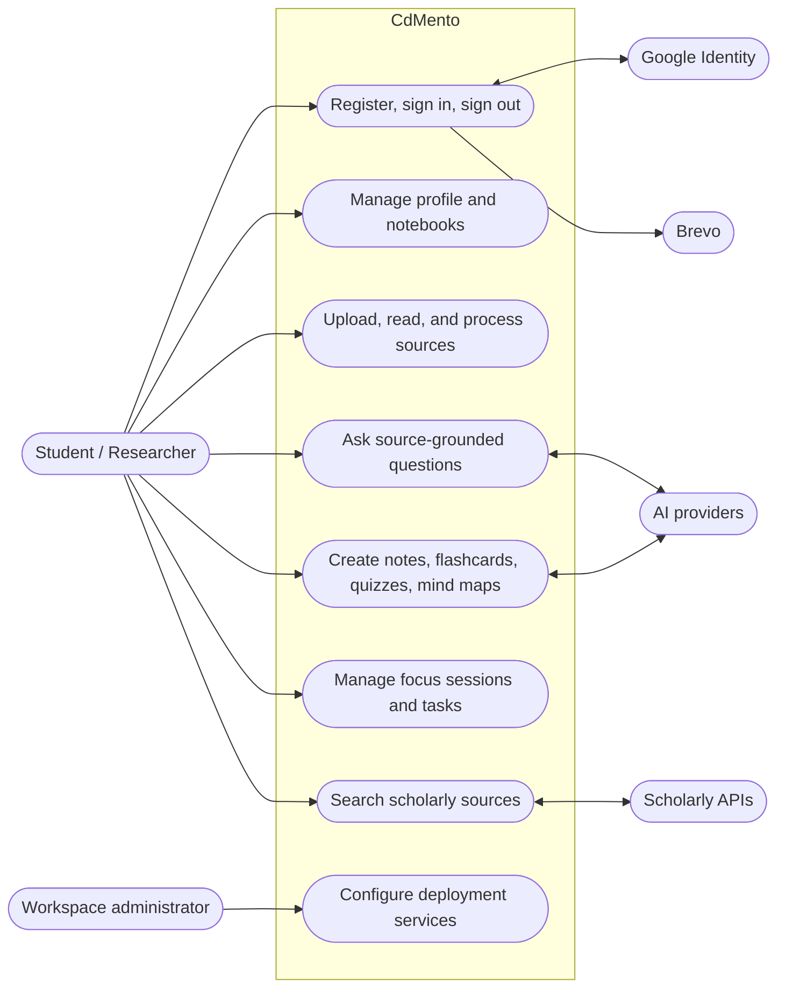
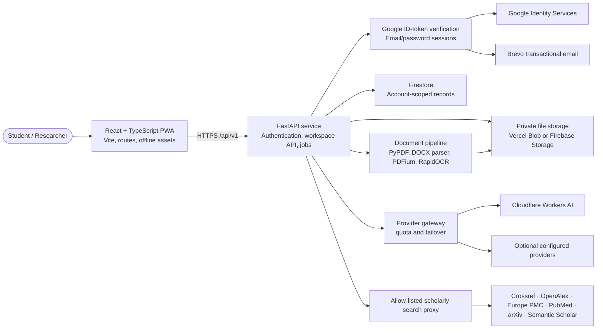

# CdMento — Your Space to Understand

> A modern, AI-powered study workspace designed for students, researchers, and lifelong learners to organize materials, master difficult concepts, and study smarter.

**Live app:** [cdmento-study-7.vercel.app](https://cdmento-study-7.vercel.app)

---

## 💡 What is CdMento?

**CdMento** is an intelligent web-based study platform and Progressive Web App (PWA). It brings together documents, lecture notes, visual mind maps, spaced repetition flashcards, quizzes, and an AI study assistant into a unified, distraction-free environment.

Instead of juggling separate apps for notes, flashcards, PDF reading, and timers, CdMento connects your entire learning workflow to your source materials.

---

## ✨ Core Features

### 📚 Document Hub & Smart Ingestion
- Upload and organize course documents in **PDF**, **DOCX**, and **TXT** formats.
- **Offline OCR Engine**: Scanned or image-only PDF pages are automatically transcribed locally using bundled neural models without exposing data to third parties.
- Split-pane reading with side-by-side extracted text, page references, and section navigation.

### 📝 Rich-Text Study Notes
- Distraction-free, responsive block-based editor.
- Auto-saving, revision tracking, and real-time formatting.
- Notebook-level organization with color-coded categories and fast search.

### 🤖 Source-Grounded AI Study Assistant
- Ask questions grounded directly in your uploaded textbooks and lecture slides.
- Every answer includes verifiable source citations and page numbers.
- Automated creation of study guides, summaries, and key concept breakdowns.

### 🔎 MentoSearch — Answer-First Topic Search
- Search a topic and get a plain-English overview with sections, key terms, and numbered citations.
- Evidence is retrieved from **Crossref, OpenAlex, Europe PMC, PubMed, arXiv, and Semantic Scholar**, then deduplicated and ranked.
- Points without a supporting paper are labeled **General knowledge**, so the overview never implies a source it does not have.
- Each evidence card links to the paper and to a **Google Scholar** verification search; the **Papers** tab keeps the full result list.
- Topic briefs are cached for 24 hours and limited to 10 per account per hour, with a fully cited digest when AI is unavailable.

### 🗂️ Spaced Repetition Flashcards (FSRS)
- Practice flashcards powered by the state-of-the-art **FSRS (Free Spaced Repetition Scheduler)** algorithm.
- AI card generator: Automatically extracts high-yield flashcard decks from any document section.
- Practice mode and due-date scheduling optimized for long-term memory retention.

### 🎯 Interactive Quizzes & Assessments
- Generate self-assessment quizzes in **Practice Mode** (instant explanations) or **Exam Mode** (timed assessment).
- Server-side grading with targeted weak-concept diagnostic feedback.

### 🧠 Concept Mind Maps
- Visualize relationships between topics with interactive node graphs.
- Add custom concepts or generate AI-assisted knowledge branches to structure complex topics.

### ⏱️ Focus Timer & Task Tracking
- Interval timer (Pomodoro technique) with custom work and rest periods.
- Session time tracking calculated against deadlines.
- In-session task checklist to maintain concentration.

### 📱 Progressive Web App (PWA) & Mobile Ready
- Installable on iOS, iPadOS, Android, macOS, and Windows.
- Offline support with background asset precaching via Service Workers.
- Mobile-first ergonomic touch interface compliant with WCAG AA accessibility standards.

---

## 🛠️ Tech Stack

| Layer | Technologies |
| --- | --- |
| **Frontend** | React 19 · TypeScript · Vite 8 · Tailwind CSS 4 · Zustand · React Router 7 · TipTap (ProseMirror) · @xyflow/react (React Flow) · PDF.js (`pdfjs-dist`) · Motion · Lucide React |
| **Backend** | Python 3.13 · FastAPI (async REST) · Pydantic v2 · SQLite · Firestore (hosted) · RapidOCR (ONNX Runtime, PyPDFium2) · PyFSRS · in-process background jobs · Brevo transactional email |
| **AI & Search** | Cloudflare Workers AI (`llama-3.3-70b-instruct`) · Groq (`gpt-oss-120b`) · OpenRouter free tier · Mistral (optional) · multi-provider failover gateway with JSON-schema enforcement |
| **Scholarly Sources** | Crossref · OpenAlex · Europe PMC · PubMed · arXiv · Semantic Scholar (optional API key) · Google Scholar link-out |
| **PWA & Accessibility** | Web App Manifest · Service Worker precaching · WCAG AA contrast · 44px touch targets |
| **Testing & Tooling** | Vitest + Testing Library · pytest · Prettier · TypeScript (`tsc --noEmit`) · GitHub · Vercel |

---

## 🔒 Privacy & Data Architecture

- **Private by Design**: Source files, notes, and personal study data remain scoped to your account.
- **Source Grounding**: AI features operate strictly on the excerpts of documents you select.
- **Offline OCR**: Optical Character Recognition runs entirely on the local CPU; document images are never sent across the network for text extraction.
- **WCAG Accessible**: High-contrast typography, screen-reader landmarks, and minimum 44px touch targets.

---

## 🚀 Run locally

From the repository root, install the frontend and Python dependencies, then create your local environment file:

```powershell
npm ci
py -3.13 -m venv .venv
.\.venv\Scripts\python.exe -m pip install -r backend\requirements-dev.txt
Copy-Item .env.example .env
npm run dev:all
```

The template configures the shared CdMento Google OAuth client for local sign-in. Each teammate must be added as a test user in the Google Cloud project's **Google Auth Platform → Audience** while the app is in testing mode. Email/password signup and password reset use Brevo transactional email; configure `BREVO_API_KEY` and a verified `BREVO_SENDER_EMAIL` in `.env`. Keep `.env` and AI provider keys private and never commit them. Each developer should supply their own AI provider keys in `.env` if they need AI features. For project layout and API details, see [docs/PROJECT_STRUCTURE.md](docs/PROJECT_STRUCTURE.md) and [docs/GOOGLE_AUTH.md](docs/GOOGLE_AUTH.md).

---

## Project Description

CdMento is a Progressive Web App for students, researchers, and independent learners who need one place to turn study materials into useful learning activities. A user creates a notebook, adds PDF, DOCX, TXT, or pasted material, then reads it alongside extracted text. The workspace supports notes, source-grounded AI conversations, flashcards, quizzes, mind maps, focus sessions, tasks, and answer-first scholarly topic briefs with Google Scholar verification links.

The system addresses three common study problems: materials scattered across apps, difficulty converting reading into active recall, and answers that are not traceable to source material. CdMento keeps material in an account-scoped notebook, produces review activities from selected sources, and returns citations where source material is used.

## Stakeholder and User Identification

| Stakeholder or user | Responsibility and access | Main needs |
| --- | --- | --- |
| Student / learner | Creates and owns notebooks, sources, notes, review activities, tasks, and profile data. Can use AI features where a provider is configured. | Fast study setup, readable materials, private data, feedback, and a usable mobile experience. |
| Researcher / advanced learner | Has the same workspace access as a student and can search supported scholarly indexes. | Reliable citations, source links, and a way to collect research material. |
| Workspace administrator / deployer | Configures authentication, persistence, file storage, email sending, and permitted AI providers through server environment variables. Has no user-content authoring role through the normal app interface. | Secure secrets, health information, quota controls, and maintainable deployment. |
| External service | Google verifies an identity; Brevo sends verification and reset email; AI providers generate learning content; scholarly APIs return search results. | Valid, rate-limited requests with only the data required for each request. |

## Functional Requirements

| ID | Requirement |
| --- | --- |
| FR-01 | The system shall allow a user to sign in with Google or create and sign in to an email/password account. |
| FR-02 | The system shall let an email/password user verify an account and reset a forgotten password through a time-limited email link. |
| FR-03 | The system shall create an account-scoped session and allow the user to sign out. |
| FR-04 | The system shall allow users to view and update their profile. |
| FR-05 | The system shall allow users to create, list, and remove notebooks. |
| FR-06 | The system shall accept PDF, DOCX, TXT, and pasted text sources, subject to the configured upload limit. |
| FR-07 | The system shall extract readable text from supported sources and use local OCR for eligible scanned PDF pages when OCR is enabled. |
| FR-08 | The system shall display an original source file, extracted text, processing status, and a retry path when processing fails. |
| FR-09 | The system shall allow users to create, save, and delete notes within a notebook. |
| FR-10 | The system shall let users ask questions about selected ready sources and retain the notebook conversation. |
| FR-11 | The system shall generate source-grounded study artifacts, including study guides, flashcards, quizzes, and mind-map content, when an AI provider is available. |
| FR-12 | The system shall let users review flashcards and record review results for spaced-repetition scheduling. |
| FR-13 | The system shall let users take quizzes, save attempts, submit answers, and receive marking or feedback. |
| FR-14 | The system shall let users create and edit a notebook mind map. |
| FR-15 | The system shall let users start and end focus sessions and manage a personal task list. |
| FR-16 | The system shall search supported scholarly sources and return an answer-first topic brief, label general-knowledge points, and link each source to Google Scholar for verification. |
| FR-17 | The system shall allow a user to export and import their workspace data. |
| FR-18 | The system shall expose a health status endpoint for deployment monitoring without returning secret values. |

## Non-Functional Requirements

| ID | Requirement |
| --- | --- |
| NFR-01 Security | API secrets, service credentials, and tokens shall remain server-side environment variables and must not be committed to version control. |
| NFR-02 Privacy | Sources, notes, and generated artifacts shall be scoped to the authenticated account. AI requests shall use only the selected source context needed for the request. |
| NFR-03 Usability | The interface shall provide clear processing, unavailable-service, and validation feedback for user actions. |
| NFR-04 Performance | The client shall upload source files in chunks and process long-running source work as jobs so the interface remains responsive. |
| NFR-05 Reliability | Records shall use revision checks to prevent silent overwrites; failed jobs shall be retryable where the feature supports it. |
| NFR-06 Maintainability | The frontend, API, document processing, authentication, repository, storage, and provider modules shall remain separated by responsibility and covered by automated tests. |
| NFR-07 Compatibility | The application shall work in current Chromium-, Firefox-, and WebKit-based browsers and remain installable as a PWA where browser support permits. |
| NFR-08 Accessibility | Core controls shall support keyboard operation, visible focus, semantic labels, WCAG AA contrast, and at least 44px touch targets for primary interactions. |
| NFR-09 Scalability | The hosted configuration shall use Firestore for records and private object storage for source files so application instances can remain stateless. |
| NFR-10 Availability | If an optional AI or scholarly provider is unavailable or its quota is exhausted, CdMento shall report that state without losing the user's notebook data. |

## Use Case Diagram



## Use Case Descriptions

### UC-01 — Authenticate and open a workspace

| Item | Description |
| --- | --- |
| Actor | Student or researcher |
| Preconditions | The user has access to the CdMento website. Google sign-in or email authentication is configured for the selected route. |
| Trigger | The user selects Google sign-in or submits an email/password form. |
| Main flow | 1. The user completes the selected authentication method. 2. CdMento verifies the identity or credentials. 3. CdMento creates a session. 4. The user is redirected to their workspace. |
| Alternate flow | An email/password user may need to verify their email; an invalid sign-in displays a neutral error message. A user who forgot a password requests a reset link. |
| Postconditions | An authenticated user can access only their own workspace records. |

### UC-02 — Add and process study material

| Item | Description |
| --- | --- |
| Actor | Student or researcher |
| Preconditions | The user is signed in and has selected or created a notebook. |
| Trigger | The user uploads a PDF, DOCX, or TXT file, or submits pasted text. |
| Main flow | 1. The browser creates an upload session and transfers file chunks. 2. The API stores the original file privately. 3. A processing job extracts text. 4. For eligible scanned PDF pages, local OCR is used when enabled. 5. CdMento marks the source ready and shows the original and extracted text. |
| Alternate flow | Unsupported or oversized files are rejected. If processing fails, CdMento displays the status and provides a retry action. |
| Postconditions | A ready source is available to the notebook's reading and study features. |

### UC-03 — Generate a source-grounded study artifact

| Item | Description |
| --- | --- |
| Actor | Student or researcher |
| Preconditions | The user is signed in, has at least one ready source, and an approved AI provider is available. |
| Trigger | The user asks a question or requests flashcards, a quiz, a study guide, or mind-map content. |
| Main flow | 1. The user selects relevant sources and the requested activity. 2. CdMento validates source readiness and provider availability. 3. The API sends selected excerpts and request context to an available provider. 4. CdMento validates the result, saves the artifact, and displays citations or source references where available. |
| Alternate flow | If a provider fails or has no quota, the gateway tries the next configured provider. If none are available, CdMento reports the unavailable state without changing the source. |
| Postconditions | The generated artifact or response is saved in the user's notebook when generation succeeds. |

## System Process Flowchart


## System Architecture



The PWA sends authenticated requests to FastAPI. FastAPI verifies identity, applies account ownership checks, reads or writes records in Firestore, and stores source bytes privately. Document processing converts sources into extracted text before an AI request is made. The AI gateway uses configured providers and returns an unavailable state when no permitted provider can serve a request. Scholarly searches are proxied by FastAPI so browser CORS restrictions and API keys remain outside the client. `POST /api/v1/search/brief` retrieves evidence, ranks it, and asks the gateway for a cited topic overview; if no provider is available, it returns a fully cited extractive digest instead.

---

## Development Methodology

CdMento follows an iterative, Agile-inspired development approach. Work is completed in small feature slices so the interface, API, persistence, and validation for a feature can be checked together before the next slice begins.

| Phase | Activities | Outputs |
| --- | --- | --- |
| Planning | Identify study workflows, user needs, feature scope, privacy needs, and free-tier service limits. | Feature list, requirements, backlog, and deployment constraints. |
| Design | Define the PWA/API boundary, account-scoped data model, document workflow, navigation, and visual system. | Architecture, data model, API contracts, component designs, and diagrams. |
| Implementation | Build React feature pages and FastAPI endpoints in small increments; connect authentication, document processing, storage, and learning tools. | Working frontend and backend feature slices. |
| Verification | Run TypeScript, Vitest, pytest, API checks, and manual workflow tests for sign-in, upload, study, and error states. | Test results, fixes, and validated behavior. |
| Review and refinement | Use observed failures, usability feedback, and provider limitations to revise validation, messages, layouts, and retry paths. | Updated implementation and documentation. |
| Release | Build the PWA, configure server-only environment variables, deploy the API and frontend, then test the hosted health and account flows. | Deployable release and operational checklist. |

## System Architecture Design

The final architecture uses a browser-based React PWA and a Python FastAPI service. The browser never receives email, database, storage, or AI-provider secrets. It sends authenticated requests to `/api/v1`; FastAPI verifies the caller, applies ownership checks, and communicates with persistence and approved external services.

| Communication path | Design |
| --- | --- |
| Frontend to API | React uses HTTPS JSON requests and an authorization bearer token. Source upload uses authenticated multipart chunks. |
| Authentication | Google Identity Services supplies an ID token that FastAPI verifies. Email/password sessions are managed by FastAPI; Brevo sends verification and reset links. Firebase Authentication can also be selected by environment configuration. |
| API to persistence | The repository layer stores hosted data in Firestore. Local development can use SQLite through the same repository interface. |
| API to source storage | `FileStorage` keeps original source bytes in configured private storage: Firebase Storage when configured, or private Vercel Blob for hosted Firestore storage. |
| API to document pipeline | FastAPI reads private source bytes, extracts PDF/DOCX/TXT text, and invokes bundled OCR only when an eligible PDF page needs it. |
| API to external providers | The AI gateway and scholarly search proxy make server-side allow-listed requests. Provider failures or quota exhaustion return a user-safe status instead of exposing credentials. |

## Database Design

CdMento uses a document-oriented model. In production, user data is stored in Firestore under an account-specific path. Local development uses SQLite records with the same owner, collection, identifier, and JSON payload model. The design avoids cross-user joins by placing each user's data in that user's document tree.

### Entity Relationship Diagram / Data Model

```mermaid
flowchart TD
    user[users/{uid}] --> profile[profile/account]
    user --> notebook[notebooks/{notebookId}]
    user --> task[tasks/{taskId}]
    user --> focus[focus_sessions/{sessionId}]
    user --> job[jobs/{jobId}]
    user --> upload[upload_sessions/{uploadId}]

    notebook --> source[sources/{sourceId}]
    notebook --> note[notes/{noteId}]
    notebook --> artifact[artifacts/{artifactId}]
    notebook --> conversation[conversations/{notebookId}]
    notebook --> map[maps/{notebookId}]
    notebook --> attempt[attempts/{attemptId}]
    notebook --> review[reviews/{eventId}]

    source --> privateFile[Private original file]
    artifact --> review
    artifact --> attempt
```

`users/{uid}` is the account boundary. Each child name in the diagram is a Firestore subcollection, and each document has an `id`. Relationships are represented by stored identifiers such as `notebook`, `artifact_id`, `source_ids`, and `deck_id`; Firestore does not enforce foreign keys, so FastAPI validates ownership and parent existence before each operation.

### Database Schema

| Collection | Document ID | Main fields | Purpose |
| --- | --- | --- | --- |
| `profile` | `account` | `email`, `display_name`, `bio`, `study_goal`, `avatar`, `color`, timestamps | Stores account profile preferences. |
| `notebooks` | notebook UUID or validated custom ID | `name`, `color`, `created_at`, `deleting`, `revision` | Groups a learner's study materials. |
| `sources` | source UUID | `notebook`, `name`, `type`, `status`, `text`, `chunks`, `checksum`, `storage_key`, page and OCR metadata | Stores source metadata and extracted study text. |
| `notes` | note UUID or validated custom ID | `notebook`, `title`, `content`, `document`, `updated_at`, `revision` | Stores rich-text notes and saved reviewers. |
| `artifacts` | artifact UUID | `notebook`, `kind`, `title`, `source_ids`, generated `cards`, `questions`, or reviewer sections, `revision` | Stores flashcard decks, quizzes, guides, and generated mind-map content. |
| `conversations` | notebook ID | `notebook`, `messages`, `summary`, `revision` | Stores source-grounded chat history for a notebook. |
| `maps` | notebook ID | `notebook`, `nodes`, `edges`, `viewport`, `revision` | Stores one editable mind map per notebook. |
| `attempts` | attempt UUID | `notebook`, `artifact_id`, `mode`, `status`, `questions`, `result`, timestamps | Stores a quiz attempt and its result. |
| `reviews` | client review event ID | `notebook`, `deck_id`, `card_id`, `rating`, `due`, `log`, `created_at` | Makes a flashcard review idempotent and preserves scheduler history. |
| `focus_sessions` | session UUID | `notebook`, `duration`, `mode`, `status`, `remaining`, `deadline`, timestamps | Stores Pomodoro-style focus sessions. |
| `tasks` | task UUID | `text`, `done`, `created_at`, `revision` | Stores personal tasks. |
| `jobs` and `upload_sessions` | UUID | status, progress, source or request references, timestamps | Tracks document processing, AI work, and resumable uploads. |
| `search_cache` | request hash | `query`, `expires_at`, `body` | Caches topic briefs for 24 hours per account, query, source set, and sort. |

For records larger than Firestore's practical document limit, the repository stores a reference to private bucket content or uses a `record_payloads/{chunkId}/parts/{partId}` collection. Original uploaded file bytes are not embedded in Firestore documents.

### Data Dictionary

| Field | Type | Description | Constraint / generation |
| --- | --- | --- | --- |
| `id` | string | Unique document identifier. | Required; system-generated UUID unless a validated import or manual ID is accepted. |
| `revision` | integer | Version number used for optimistic concurrency control. | System-generated and incremented on every successful repository write. |
| `notebook` | string | Parent notebook identifier. | Required for notebook-bound sources, notes, artifacts, maps, attempts, conversations, and reviews. |
| `name` / `title` | string | User-visible name for a notebook, source, note, deck, quiz, or reviewer. | Required where applicable; validated length limits depend on the request schema. |
| `color` | enum string | Visual color selected for a profile or notebook. | One of `purple`, `blue`, `green`, `orange`, or `pink`. |
| `type` | enum string | Source file format. | `pdf`, `docx`, or `txt`. |
| `status` | enum string | State of a source, job, attempt, or focus session. | Server-controlled transitions such as `queued`, `extracting`, `ready`, `failed`, `active`, or `completed`. |
| `text` | string | Extracted readable source text or plain note text. | Source text is generated by the document pipeline; note content is limited by request validation. |
| `chunks` | array of objects | Source excerpts with page, section, and OCR metadata. | Generated during extraction and used for source grounding. |
| `storage_key` | string | Private object-storage location of an original source file. | System-generated; never returned by public source responses. |
| `source_ids` | array of strings | Sources used by an artifact, card, quiz question, or answer. | Must reference selected sources in the same notebook. |
| `messages` | array of objects | User and assistant conversation entries. | Kept per notebook; server keeps recent history and a bounded summary. |
| `created_at` / `updated_at` / `finished_at` | ISO-8601 timestamp string | Record lifecycle times. | System-generated by the backend. |
| `checksum` | SHA-256 string | Digest of uploaded source bytes. | System-generated; used to identify duplicate uploads in a notebook. |

### Database Implementation

FastAPI accesses data only through `Repository` or `FirestoreRepository`. Both implementations expose `get`, `list`, `put`, and `delete`, so feature code does not need separate database logic for local and hosted modes. The Firestore implementation uses `users/{uid}/{collection}/{id}` paths and Firestore transactions for writes that require an expected `revision`.

The authenticated user ID is passed to every repository operation. API helpers check the requested record and its parent notebook before returning, updating, or deleting it. This enforces account ownership at the API boundary. Pydantic request schemas reject unknown fields and validate lengths, ranges, enum values, IDs, duplicate quiz options, map relationships, and upload sizes before persistence. Deleting a notebook is handled as a job so related records and private source files can be removed in a controlled sequence.

## User Interface and User Experience Design

The interface is built around a learner's normal study sequence: enter a workspace, choose a notebook, add material, read or create learning activities, then return to the same notebook later. The public landing pages introduce the product and authentication routes; protected workspace pages use a consistent left navigation, notebook context, content area, and status feedback.

The implemented React pages act as functional prototypes. The source reader uses an original-file and extracted-text view; notes use a focused editor; flashcards and quizzes use dedicated practice layouts; mind maps use an interactive graph; and the focus timer uses a task-oriented view. MentoSearch opens on an **Answer** tab with numbered citations, evidence cards, and per-source Google Scholar verification links; its **Papers** tab keeps the full ranked list. This keeps each learning activity visually appropriate while preserving the same account and notebook context.

The layout adapts from desktop panels to a mobile navigation drawer at smaller widths. The public pages and workspace include responsive CSS breakpoints, touch-friendly controls, light and dark themes, visible focus treatment, and reduced-motion support through Motion's user preference setting.

### User-Centered Design

The following learner needs guide the implemented design decisions:

| Learner need | Design response |
| --- | --- |
| Keep study material in one place | Notebook-scoped sources, notes, artifacts, tasks, and conversations. |
| Understand difficult or scanned material | Split source reading, extracted text, OCR status, page information, and retry feedback. |
| Turn passive reading into practice | Flashcards, quizzes, mind maps, reviewer guides, focus sessions, and tasks. |
| Trust generated help | Source selection, citations, source references, provider status, and clear unavailable or quota messages. |
| Study on different devices | PWA installation, responsive panels, mobile drawer navigation, accessible touch targets, and reduced-motion support. |

The interface keeps error messages close to the action that caused them and offers recovery when available, such as retrying a source-processing job, retrying an unavailable connection, or requesting another password-reset link.

### Navigation Design

Public navigation provides the landing page, Get the app page, login, signup, forgot-password, email verification, and action-link routes. After authentication, the primary sidebar provides Home, Notebooks, Sources, MentoSearch, AI Assistant, Notes, Flashcards, Quizzes, Mind Maps, and Focus Timer. The bottom area provides profile access and logout.

The selected notebook is the user’s working context. A learner can create or select a notebook from the sidebar, then reach Sources to add material, use AI Assistant or generated activities after the source is ready, and return to Notes or the home workspace without leaving the account. Unknown protected paths redirect the learner back to the workspace. On mobile, the sidebar becomes a dismissible navigation drawer.

## Frontend Development

The frontend uses React 19, TypeScript, Vite, React Router, Zustand, TipTap, React Flow, PDF.js, Motion, and Lucide icons. `BrowserRouter` separates public routes from the protected workspace, while heavier feature pages such as Profile, Notes, Flashcards, Quizzes, Mind Maps, Focus, and MentoSearch are lazy-loaded.

`SessionProvider` manages local demo, Google, email/password, and Firebase session states. The shared API helper adds the bearer token to `/api/v1` calls, converts unsuccessful responses into typed errors, and protects original-file requests by sending the token in a request header rather than a URL. Forms and API inputs receive client feedback, while FastAPI's Pydantic schemas provide the authoritative server validation.

The frontend polls processing jobs to show source and generation progress, uses toast and inline feedback for successful and failed actions, and supports retry paths for recoverable failures. In production, the PWA registers a service worker for offline asset caching; development mode removes stale workers so they do not interfere with hot reloading.
